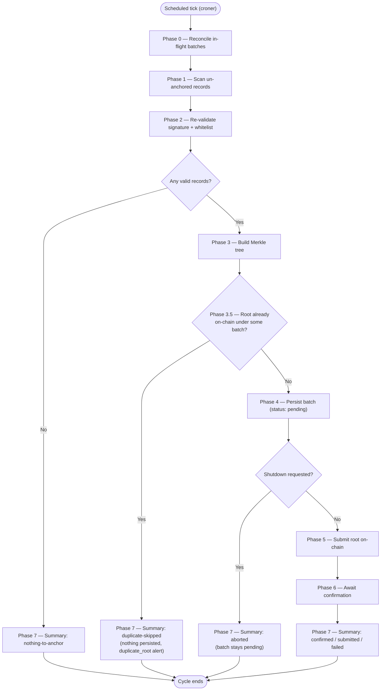

# `anchor-service` — Execution Cycle

`anchor-service` ([`apps/anchor-service`](../../apps/anchor-service)) is the long-lived daemon responsible for Flow 1 of the architecture (see [`ARCHITECTURE.md`](ARCHITECTURE.md) §3): it periodically collects business records that have not yet been anchored, re-validates them, builds a Merkle tree, writes the resulting root to the [`MerkleAnchorRegistry`](../../apps/integrity-domain/contracts/MerkleAnchorRegistry.sol) smart contract, and persists the batch and every record's individual proof. It is the **only** component in the system that holds a funded wallet and writes to the blockchain — `monitor-service` only ever reads.

This document describes, step by step, everything the daemon does from process start to process exit: how it starts up, how it schedules its own work, what exactly happens inside a single execution cycle, and how it shuts down without losing or duplicating work.

---

## 1. Daemon Lifecycle

`anchor-service` is not a script that runs once — it is a long-running Node.js process (`apps/anchor-service/src/index.ts`) with three lifecycle stages: startup self-checks, a scheduled loop of execution cycles, and graceful shutdown.

### 1.1. Startup Self-Checks (Fail-Fast)

Before scheduling anything, the process validates its own environment and its ability to talk to both Postgres and the blockchain. Every check is fail-fast: if any of them fails, the process logs the error and exits immediately, rather than starting a scheduler that could never actually do useful work.

1. **Configuration parsing** (`src/config.ts`) — every required environment variable (`DATABASE_URL`, `RPC_URL`, `ANCHOR_CHAIN_ID`, `ANCHOR_PRIVATE_KEY`) must be present and well-formed; `ANCHOR_PRIVATE_KEY` must be a syntactically valid 32-byte hex string. `CONTRACT_ADDRESS` is optional — if absent, the target contract's address is resolved from `packages/contracts-shared`'s committed per-chain deployment registry, keyed by `ANCHOR_CHAIN_ID`. Every optional tuning variable is listed in §6.
2. **Empty whitelist warning** — if `WHITELIST_ADDRESSES` is empty, the process logs a prominent warning (not a fatal error) because this is a fail-closed condition: with no whitelisted address, every single record will fail Phase 2's validation and nothing will ever be anchored.
3. **Database connectivity** — a `SELECT 1` against the configured Postgres pool.
4. **Network identity** — the connected RPC endpoint's `chainId` (via `provider.getNetwork()`) must match the configured `ANCHOR_CHAIN_ID`, so the daemon can never accidentally submit to the wrong network.
5. **Contract deployment** — the resolved contract address must actually have bytecode on that network (`provider.getCode()` must not return `"0x"`).
6. **Wallet ownership** — the wallet derived from `ANCHOR_PRIVATE_KEY` must be the contract's `owner()`, since `addMerkleRoot` is `onlyOwner`. If it isn't, every submission would revert with `OwnableUnauthorizedAccount`, so this is caught here instead of on the first real cycle.

If any of steps 3-6 throws, the database pool and the chain provider are both closed before the process exits, so a failed startup never leaves dangling connections. If they all succeed, the pool and provider are deliberately **not** closed — they stay open for the scheduler's entire lifetime.

### 1.2. Scheduling

Once startup succeeds, `createCycleScheduler` wraps the whole execution cycle (§2 below) in a [`croner`](https://github.com/Hexagon/croner) job, configured with the cron expression in `ANCHOR_CRON_SCHEDULE` (default: `0 */3 * * *`, every 3 hours).

The scheduler's only real job beyond triggering the cycle on time is **overlap protection**: croner's own `protect: true` option guarantees that if one cycle is still running when the next scheduled tick arrives, that tick is simply skipped — at most one cycle ever runs at a time, in a single process. This is deliberately the *only* concurrency guard; there is no separate hand-rolled `isRunning` flag, since croner's own mechanism already covers it, and the same in-flight-cycle tracking is also what the shutdown sequence (§1.3) needs to know what to wait for.

(A second, independent instance of the daemon running concurrently — e.g. two containers pointed at the same database — is not prevented by `protect: true`, since that only guards a single process. That scenario is instead made safe by idempotency checks inside the cycle itself; see §3.)

### 1.3. Graceful Shutdown

On `SIGTERM` or `SIGINT`, the process does not exit immediately:

1. The croner job is stopped (`cron.stop()`) — no new cycle will ever start after this point.
2. A cooperative abort flag is flipped. The *currently running* cycle, if any, reads this flag at exactly one checkpoint (see Phase 4/5 below) and, if set, stops cleanly instead of starting a blockchain transaction.
3. If a cycle is in flight, the shutdown sequence waits for it to finish — but only up to `SHUTDOWN_GRACE_MS` (default: 600,000 ms / 10 minutes, which must comfortably exceed the longest realistic confirmation wait).
4. If the in-flight cycle finishes within the grace period, the database pool is closed and the chain provider is destroyed, and the process exits cleanly.
5. If the grace period elapses first (the cycle is genuinely stuck — for example, waiting on a transaction that will never confirm), the process hard-exits with a non-zero code instead of waiting indefinitely or risking a partial shutdown on a stuck cycle.

The cooperative abort checkpoint is placed at exactly one point in the whole cycle: right after Phase 4 (persist) and before Phase 5 (submit). Every earlier phase is redundant to interrupt, because croner's `stop()` already guarantees no *new* cycle starts; and every later phase (submit/confirm) is deliberately left to run to completion once started, so a transaction is never abandoned mid-flight — see Phase 6 for why an interrupted confirmation wait is still safe.

**SIGTERM during a CPU-bound stretch.** The image starts the service with `node --import tsx src/index.ts` (not the `tsx` CLI, which runs a supervising parent process that `SIGKILL`s a child whose event loop cannot acknowledge a relayed signal within ~60 ms — exit 143, no graceful path; found in the E2E plan, §8). With a plain `node` process, a SIGTERM that lands during a long synchronous stretch (Phase 1's signature validation of a large backlog, the Merkle tree build) is simply handled as soon as the event loop is free again: `shutdown requested` is logged, the cycle continues to the Phase 4→5 checkpoint, leaves the persisted batch `pending` and exits 0 — shutdown takes as long as the remaining stretch, not zero. The dev override still runs `tsx watch`, which caps every shutdown at 5 s.

---

## 2. The Execution Cycle

Each scheduled tick runs exactly one execution cycle, implemented by `runCycle` (`src/cycle.ts`). A cycle is a strict sequence of eight numbered phases, 0-7, plus one guard between Phases 3 and 4 (Phase 3.5). Phase 0 is a "before everything else" phase, not the first step of building a new batch.



The same phases, as a plain-text list:

```text
Phase 0    Reconcile in-flight batches (left over from a previous cycle/crash)
Phase 1    Scan for un-anchored records
Phase 2    Re-validate each record (signature + whitelist)
Phase 3    Build the Merkle tree
Phase 3.5  Skip the batch if its root already exists on-chain
Phase 4    Persist the batch (durable, before anything touches the chain)
  ── cooperative shutdown checkpoint ──
Phase 5    Submit the root on-chain
Phase 6    Await confirmation
Phase 7    Assemble and log the cycle summary
```

If, after Phase 1-2, there are zero valid records to anchor, the cycle short-circuits straight to Phase 7 with a `nothing-to-anchor` summary — Phases 3-6 never run, and no empty batch is ever created. If Phase 3.5 finds the root already on-chain, the cycle likewise ends early with a `duplicate-skipped` summary and persists nothing.

### Phase 0 — Reconcile In-Flight Batches

**Responsibility:** resolve every batch left in a non-terminal state (`pending`, `submitted`, or `failed`) by a *previous* cycle — because the process crashed, was killed, or the blockchain was simply slow between cycles — before doing any new work. This phase never creates new batches; it only drives existing ones to a terminal state (`confirmed` or `failed`).

Implemented by `reconcileBatches` (`src/reconcile.ts`). For every in-flight batch, in order:

1. **Already-on-chain fast path.** Regardless of the batch's recorded status, the phase first asks the contract whether the batch's `merkle_root` is already registered (`containsMerkleRoot`, then `getBatchIdByRoot` for the batch id it was registered under — gas-free reads of the contract's stored state, never event logs). A root registered under *this batch's own id* means the batch is done: it is marked `confirmed` (the block number and timestamp recorded with it come from the root's `RootAdded` event — the only place this service still reads logs, and only for its own batch). This single check resolves the most common crash scenario (the transaction was actually mined before the process died, but the local database never heard about it) without needing to inspect the specific status at all. A root registered under a *different* batch id can never give this batch its own `BatchInfo`, so the batch is marked `failed` (once) and a `duplicate_root` alert is written (Phase 3.5 explains how that situation arises).
2. **`pending` batches** (persisted, but no transaction was ever sent) are submitted for the first time here, exactly as Phase 5 would.
3. **`submitted` batches** (a transaction was sent, but the process died before it confirmed) have their transaction hash inspected via a non-blocking receipt poll:
   - **confirmed** → the root is looked up on-chain again and the batch is marked `confirmed` only if it is registered under *this batch's own id*. A confirmed receipt alone proves some transaction was mined, not that it anchored this batch (`transaction_hash` is as writable as `merkle_root`), so a confirmed transaction whose root is not on-chain is treated as unreconcilable, and one whose root belongs to another batch is handled as a duplicate root.
   - **reverted** → mark `failed`.
   - **pending-confirmations** (mined, but not yet past the required confirmation count) → left alone, re-checked next cycle.
   - **missing** (the transaction was dropped or never propagated) → the batch's records are re-streamed and the root recomputed first; only if it still matches the stored root is the transaction resent as a replacement (same nonce, bumped fee). A divergence, or a batch with no `anchor_records` left at all, is treated as unreconcilable (see below). If the node no longer knows the stuck transaction (dropped from the mempool, so there is no nonce to replace), the batch is submitted again as a fresh transaction; if that root has landed after all, the contract reports `RootAlreadyExists` and the batch is settled like any already-on-chain root. If the resend itself fails (fee cap, RPC error, underpriced replacement), the batch stays `submitted`, the failure is logged at error level, and the rest of the cycle still runs — Phase 0 retries it next cycle.
   - A `submitted` row with **no transaction hash** cannot be inspected or resent at all (this service always records the hash), so it is also treated as unreconcilable.
4. **`failed` batches** are not simply retried blindly. First, the record set pinned to the batch (`anchor_records`) is re-streamed from the database and the Merkle root is *recomputed* from scratch. Only if the recomputed root still matches the originally stored root is the batch resubmitted (through the same `submitRoot` path as Phase 5, so a `RootAlreadyExists` revert is settled by ownership exactly as there) — if it diverges, that is treated as a sign of possible tampering with the pinned batch data itself, logged loudly, and **not** auto-resolved; it needs a human. If a `failed` batch's retry count crosses `ANCHOR_RETRY_ALERT_THRESHOLD` (default: 5), a loud log line is emitted regardless of outcome, since a batch failing repeatedly usually means something structural is wrong (the wallet lost ownership, ran out of gas funds, or a configuration value is stuck).

**Unreconcilable batches.** When a batch can't be reconciled safely — its pinned records no longer rebuild its stored root, it has no pinned records to rebuild from, or its recorded state is impossible (`submitted` with no transaction hash) — the phase never resends or confirms it. It marks the batch `failed` (once: an already-failed batch is not re-marked, so `retry_count` doesn't grow every cycle), writes a `root_divergence` alert with `source = 'anchor'` (`expected_root` = the stored root, `actual_root` = the rebuilt root, or null when there was nothing to rebuild it from; deduplicated per batch, so a batch re-evaluated every cycle alerts once), and **carries on with the rest of the cycle**. This is a per-batch failure on purpose: one forged or damaged `batches` row — which any holder of `INSERT` on `batches` can create — must not be able to halt all anchoring (E2E plan scenarios 8 and 13c).

This design means the system has **no automatic batch abandonment**: a batch that can safely be retried keeps being retried every cycle, indefinitely, until it either succeeds or is manually intervened on; one that cannot be reconciled safely stays `failed` and is re-examined every cycle, with its single alert already written, until a human intervenes.

### Phase 1 — Scan Un-Anchored Records

**Responsibility:** find every record that has not yet been anchored.

Implemented by `streamUnanchoredRecords` (`src/records-source.ts`): a single SQL query selects every row in `records` with no matching row in `anchor_records` (`NOT EXISTS`), ordered by `id`. The query is executed as a **stream** (`pg-query-stream`), fetching rows in batches of 10,000 by default, so the daemon's memory usage is bounded by the size of one fetch batch rather than by the total number of un-anchored records — this matters because the scan is expected to run against potentially very large backlogs.

### Phase 2 — Re-validate Each Record

**Responsibility:** re-check, independently of whatever `data-domain` already checked at write time, that each record is still legitimately signed and still permitted to be anchored.

Implemented by `validateRecord` (`src/validation.ts`), applied to every record streamed by Phase 1. Two checks, both of which must pass, evaluated in this order:

1. **Signature validity.** The signer is recovered from the ECDSA signature over the canonical JSON of the record's full *signable content* — `recordType`, `data` (the payload), `version`, `isDeleted`, `replaces`, and `entityId` (`null` for an original/create row, the entity's real id for an update or delete) — and must equal the address stored in `client_address`. Because those fields are inside the signed message, editing any of them directly in Postgres before the record is anchored breaks the signature. `id`, `created_at` and a create's `entity_id` are minted by the database *after* the client has signed, so no signature can cover them (see `docs/overview/signature/signature-verification.md` for exactly what this check can and cannot catch). A malformed signature string is simply an invalid signature; it does not throw.
2. **Whitelist membership.** The same address must currently be present in `WHITELIST_ADDRESSES`.

These are two genuinely independent checks: a record can have a perfectly valid signature (the signer really is who `client_address` claims) while still failing validation, because the whitelist is re-checked at anchor time, not just at ingestion time — an address that was authorized when the record was written may have since been removed from the whitelist, and a forger signing with their own key produces a valid signature that is not whitelisted. A record only proceeds to Phase 3 if **both** checks pass.

Any record that fails either check is:
- excluded from the batch entirely (it is *not* anchored this cycle, and remains "un-anchored" — it will be re-scanned by Phase 1 on the very next cycle, since it has no `anchor_records` row);
- recorded as a `signature_mismatch` alert in `integrity_alerts`, deduplicated by `record_id` — a permanently-bad record is re-scanned and re-rejected every cycle, but only ever generates **one** alert, not one per cycle. The alert's `details` carries the reason: `signature does not match payload or client_address`, or `signer 0x… is not whitelisted`.

### Phase 3 — Build the Merkle Tree

**Responsibility:** turn the set of records that passed Phase 2 into one Merkle root and one inclusion proof per record.

Implemented by `buildAnchorTree` (`src/tree.ts`), a thin wrapper over `packages/crypto-utils`'s `buildMerkleTree` — the single source of truth for this logic across the whole system, kept byte-for-byte compatible with the `MerkleAnchorRegistry.sol` contract's own OpenZeppelin-based proof verification (see [`ARCHITECTURE.md`](ARCHITECTURE.md) §5). Input order is irrelevant: the library sorts leaves by hash, which is why the schema has no `leaf_index` column. If Phase 2 rejected every record and none are left, Phase 3 never runs at all — the cycle short-circuits to a `nothing-to-anchor` summary (Phase 7) instead of ever calling the tree builder with an empty input.

**Memory.** The tree and every proof are materialised at once, which costs roughly 2.5 KB per leaf (measured: about +257 MB and 29 s for 100,000 leaves, +756 MB and 96 s for 300,000), so a very large backlog is the main way this daemon can run out of memory. `ANCHOR_MAX_BATCH_SIZE` is parsed and validated by `loadConfig`, but this version does not yet split a backlog into capped batches (that work lives on the `anchor-max-batch-size` branch); for now the setting is only read by `monitor-service`, as the size up to which it rebuilds a batch's root in memory.

### Phase 3.5 — Skip a Root That Already Exists On-Chain

**Responsibility:** make sure a batch is never persisted for a root the contract would reject.

Implemented inline in `runCycle`, via `findRootOnChain` (`src/chain-confirm.ts`: `containsMerkleRoot`, then `getBatchIdByRoot` for the owner). The contract accepts each root exactly once, under one batch id. A freshly computed root that already exists can therefore only mean the same set of leaves was anchored before — typically because someone deleted the `anchor_records` pins of an already-anchored batch, or the whole batch row, which makes the very same records look "un-anchored" again and rebuild the very same root (E2E plan scenarios 4 and 5). Persisting a new batch for it would create a `confirmed` batch that has no `BatchInfo` of its own — a phantom nothing could ever reconcile. So when the root already exists, the cycle:

- persists nothing (no batch row, no pins) and sends no transaction;
- writes one `duplicate_root` alert (`source = 'anchor'`, `batch_id` null, `actual_root` = the root, deduplicated by that root). The message names the owning batch and whether its row still exists in Postgres (its pins were likely deleted) or not (its row and pins were likely deleted);
- ends with a `duplicate-skipped` summary.

The same records give the same root on the next cycle, so the situation is re-detected every cycle — logged at error level the first time and as a warning afterwards — until a new record changes the set.

### Phase 4 — Persist the Batch

**Responsibility:** make the batch's membership durable in Postgres *before* anything is sent to the blockchain.

Implemented by `persistBatch` (`src/batch-repository.ts`), as a single database transaction:

1. Insert one row into `batches`, with `status = 'pending'`, the computed `merkle_root`, and the record count.
2. Bulk-insert one row per record into `anchor_records` (`record_id`, `batch_id`, `merkle_proof`) via Postgres's `COPY … FROM STDIN` protocol for speed at scale, rather than one `INSERT` per record.

Both steps happen inside the same transaction, so a batch's membership is atomic: either every one of its records is durably pinned to it, or none are. This ordering — persist first, submit second — is deliberate: once this phase completes, the batch exists durably in the database with a `pending` status, so even if the process crashes immediately afterward, Phase 0 of the *next* cycle will find it and submit it. No batch's membership is ever decided by, or dependent on, anything that happens on-chain.

This is also the cooperative shutdown checkpoint described in §1.3: immediately after this phase, and before Phase 5, `runCycle` checks the shutdown-requested flag. If it is set, the cycle stops here — the batch is left `pending` in the database (safe, since Phase 0 will pick it up on the next process start) and Phases 5-6 never run, so a shutdown never interrupts an in-flight blockchain transaction.

### Phase 5 — Submit the Root On-Chain

**Responsibility:** get the batch's Merkle root registered on the smart contract, exactly once, handling transient failures without either losing the batch or double-spending gas.

Implemented by `submitAndConfirmBatch` (`src/cycle.ts`), calling into `submitRoot` (`src/chain-submit.ts`):

1. **Idempotency pre-check.** Before ever sending a transaction, the phase asks `findRootOnChain` again about this root (the same gas-free reads Phase 0 uses). Duplicates caused by deleted pins are already stopped in Phase 3.5; this check is the narrow safety net for the *same batch* having been submitted by a concurrent Phase 0 reconciliation (from this same cycle or another instance) racing this exact Phase 5. A root owned by this batch's own id means the batch is marked `confirmed` immediately and no transaction is sent; a root owned by a different batch id marks this batch `failed` and writes a `duplicate_root` alert.
2. **Sending the transaction.** If the root genuinely isn't on-chain yet, `addMerkleRoot(root, size, batchId)` is invoked — the batch's own row id is the `batchId`, and the contract rejects both a root and a batch id it has already seen. Sending uses [`p-retry`](https://github.com/sindresorhus/p-retry) with up to `ANCHOR_TX_RETRIES` attempts (default: 4). The very first attempt uses whatever fee the network currently reports; every retry after that — regardless of what caused the previous attempt to fail — carries an escalating fee bump (the current fee data × (1 + 0.25 × attempt number): ×1.25, ×1.5, ×1.75, …), capped at `ANCHOR_MAX_FEE_GWEI` (default: 100 gwei), so a series of underpriced attempts converges instead of retrying forever at the same losing price.
3. **Revert classification.** Reverts are not all treated the same, because retrying a deterministic revert would just fail identically every time:
   - `RootAlreadyExists` — the root (or the batch id) is already registered. It is not blindly treated as success: the phase looks up who owns the root. Owned by this batch → marked `confirmed` from a fresh on-chain lookup (another instance or a Phase 0 reconciliation beat this cycle to it); owned by a different batch → `failed` plus a `duplicate_root` alert.
   - `OwnableUnauthorizedAccount` — the wallet is no longer the contract's owner. This aborts immediately, without retrying, and is treated as a structural, "poison batch" failure — no amount of retrying fixes a wrong wallet.
   - Any other named revert — also aborted immediately as a non-retryable failure, since a deterministic contract-level rejection will not change on a retry.
   - Anything else (network blips, RPC timeouts, rate limiting) — genuinely transient, and retried per the fee-bump schedule above.

### Phase 6 — Await Confirmation

**Responsibility:** wait, within the same cycle, for the submitted transaction to reach the required confirmation depth, and record its final, terminal outcome.

Implemented by `awaitConfirmation` (`src/chain-confirm.ts`), blocking until either `ANCHOR_CONFIRMATIONS` (default: 3; 2 is the typical setting for Polygon Amoy) confirmations are reached, or `ANCHOR_CONFIRMATION_TIMEOUT_MS` (default: 300,000 ms / 5 minutes) elapses. Three distinct outcomes:

1. **Confirmed successfully** — the batch is marked `confirmed`, with the block number and timestamp it was included in and, when the receipt is available, the gas used and gas price.
2. **Mined but reverted** — the one case this wait can conclusively resolve as bad news: the batch is marked `failed`.
3. **Timeout, or any other error while waiting** (network drop, RPC unavailability) — the batch is **not** marked `failed`. It is deliberately left in `submitted` state, because at this point its true on-chain fate is genuinely unknown — the transaction could still confirm later. This unresolved state is exactly what Phase 0 of the *next* cycle exists to clean up: it will poll the same transaction hash again and resolve it to whatever it actually became.

This is why Phase 6 never needs its own retry loop: an inconclusive wait simply defers resolution to the next cycle's Phase 0, rather than the current cycle blocking indefinitely or guessing at an outcome it cannot yet know.

### Phase 7 — Cycle Summary

**Responsibility:** assemble one structured record of everything this cycle did, for logging and future analysis.

Implemented by `buildCycleSummary` (`src/metrics.ts`). Every cycle — whether it anchored a batch, found nothing to anchor, was aborted for shutdown, or failed — ends by emitting exactly one structured summary, containing:

- the cycle number and its final `status` (`confirmed` | `submitted` | `failed` | `nothing-to-anchor` | `duplicate-skipped` | `aborted`);
- Phase 0's reconciliation counts (`confirmed`/`resent`/`failed` batches resolved that cycle);
- how many records were scanned and how many were rejected in Phase 2;
- how many records ended up in the batch, its root, its transaction hash, its block number, and the gas used and gas price (whichever of these apply to that cycle's outcome — most are `null` for a `nothing-to-anchor` cycle);
- a millisecond timing breakdown per stage (`reconcile`, `scanAndValidate`, `tree`, `duplicateCheck`, `persist`, `submit`, `confirm` — whichever ran), so a slow cycle can be diagnosed by which specific stage took the time, and the cycle's total duration;
- a peak memory (RSS) snapshot, to catch memory growth from very large scans before it becomes an operational problem.

This summary is the daemon's only structured, machine-parseable output about its own behavior — it is what an operator (or the benchmark harness under `apps/anchor-service/bench/`) would read to understand what a given cycle actually did.

---

## 3. Idempotency and Concurrency Safety (Recap)

Several of the phases above independently guard against the same underlying risk — that the same batch could be submitted to the chain more than once, that the same set of records could be anchored under two batch identities, or that two overlapping executions (across cycles, across a crash-and-restart, or across two instances of the daemon) could race each other:

- **Within one process:** croner's `protect: true` (§1.2) guarantees at most one cycle runs at a time.
- **Across a crash and restart, or a slow chain between cycles:** Phase 0 (§ above) reconciles whatever the previous cycle left in a non-terminal state before any new work happens.
- **Across concurrent submissions of the exact same root** (whether from this cycle's own Phase 0 racing its own Phase 5, or, in principle, a second daemon instance pointed at the same database and chain): Phase 5's idempotency pre-check, and the ownership-aware handling of `RootAlreadyExists`, both mean a duplicate submission attempt resolves to the correct `confirmed` state instead of failing or double-spending gas.
- **The same records anchored under a second batch identity** (the pins of an anchored batch, or the whole batch, deleted from Postgres so the records look un-anchored again): the contract accepts a root once, so Phase 3.5 detects the repeat *before* persisting anything, from the contract's own stored state (never from Postgres), and raises `duplicate_root` instead of creating a phantom batch.
- **Duplicate batch *membership*** (the same record ending up pinned to two different batches) is prevented one layer below all of this, by Postgres's own `UNIQUE(record_id)` constraint on `anchor_records` — the real first line of defense, not application logic.

---

## 4. Batch Lifecycle (State Machine)

Every batch created by Phase 4 moves through a small state machine, entirely driven by the phases described above:

```text
pending ──(Phase 5, or Phase 0 on a later cycle, sends the transaction)──> submitted
pending ──(the send fails)──> failed
submitted ──(Phase 6 or Phase 0: the root is on-chain under this batch's own id)──> confirmed
submitted ──(Phase 6 or Phase 0 sees a revert)──> failed
submitted ──(Phase 0: no receipt; replaced or resubmitted)──> submitted
failed ──(Phase 0 recomputes the same root and resubmits)──> submitted
pending | submitted | failed ──(root owned by another batch, or unreconcilable)──> failed, with an alert
```

`confirmed` is the only state a batch leaves this machine in for good. `failed` is not truly terminal: as described in Phase 0, a `failed` batch whose records still rebuild its stored root keeps being retried by every subsequent cycle, forever, unless a human intervenes. A batch that is `failed` because its root belongs to another batch, or because it is unreconcilable (its pins no longer rebuild its root, it has none, or its recorded state is impossible), is deliberately *not* retried: it stays `failed` and keeps being re-examined every cycle at warning level, with its single alert already written. There is no automatic abandonment of a batch anywhere in this system.

---

## 5. Alerts Written by `anchor-service`

All rows are written to `integrity_alerts` with `source = 'anchor'`; `monitor-service`'s own alerts are listed in its document.

| `alert_type` | Written by | `batch_id` | `record_id` | `expected_root` | `actual_root` | Deduplicated by |
|---|---|---|---|---|---|---|
| `signature_mismatch` | Phase 2 — a record failed the signature or whitelist check | `null` | the record | `null` | `null` | `record_id` |
| `duplicate_root` | Phase 3.5 — the rebuilt root already exists on-chain (`batch_id` `null`); Phase 0 / Phase 5 — this batch's root is owned by another batch (`batch_id` = the failed batch) | `null` or the failed batch | `null` | `null` | the root | `actual_root` |
| `root_divergence` | Phase 0 — an unreconcilable batch (rows no longer rebuild the stored root, no pins left, `submitted` with no transaction hash, or a confirmed transaction whose root is not on-chain) | the batch | `null` | the batch's stored root | the rebuilt root, or `null` when there was nothing to rebuild from | `batch_id` |
| `record_tampered` | Phase 0 — a record of an in-flight batch cannot even be hashed (e.g. a malformed `client_address`) | the batch | the record | `null` | `null` | `record_id` |

---

## 6. Configuration Reference

Required: `DATABASE_URL`, `RPC_URL`, `ANCHOR_CHAIN_ID`, `ANCHOR_PRIVATE_KEY` (`loadConfig`, `src/config.ts`). Everything else is optional:

| Variable | Default in code | Effect |
|---|---|---|
| `CONTRACT_ADDRESS` | resolved from the committed deployment registry for `ANCHOR_CHAIN_ID` | Address of `MerkleAnchorRegistry`. |
| `WHITELIST_ADDRESSES` | empty (every record is rejected, with a startup warning) | Comma-separated addresses allowed to sign records (Phase 2). |
| `ANCHOR_CRON_SCHEDULE` | `0 */3 * * *` | When cycles start (§1.2). |
| `ANCHOR_CONFIRMATIONS` | `3` | Confirmations to wait for in Phase 6 and Phase 0. (`docker-compose.yml` sets `1` for the local Hardhat node.) |
| `ANCHOR_CONFIRMATION_TIMEOUT_MS` | `300000` | How long Phase 6 waits before leaving the batch `submitted`. |
| `ANCHOR_MAX_FEE_GWEI` | `100` | Cap on the escalating fee bump (Phase 5, and the Phase 0 replacement). |
| `ANCHOR_TX_RETRIES` | `4` | `p-retry` attempts when sending a transaction. |
| `ANCHOR_RETRY_ALERT_THRESHOLD` | `5` | Retry count at which a `failed` batch logs a loud "poison batch" error (Phase 0). |
| `ANCHOR_MAX_BATCH_SIZE` | unset | Parsed and validated, **not yet enforced** by this daemon (see Phase 3). `monitor-service` reuses it as its root-rebuild limit. |
| `SHUTDOWN_GRACE_MS` | `600000` | Grace period for an in-flight cycle on shutdown (§1.3). |
| `LOG_LEVEL` | `info` | pino log level. |
