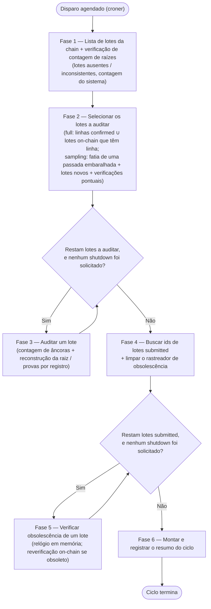

# `monitor-service` — Ciclo de Execução

O `monitor-service` ([`apps/monitor-service`](../../apps/monitor-service)) é o daemon de longa duração responsável pelo Fluxo 2 da arquitetura (ver [`ARCHITECTURE.md`](ARCHITECTURE.md) §3): periodicamente, ele re-deriva o estado de cada lote já ancorado diretamente das tabelas `records`/`anchor_records` e da própria blockchain, e dispara um alerta no momento em que qualquer uma das duas divergir do que foi de fato ancorado. Ele nunca assina nem envia uma transação na blockchain, e nunca escreve no Postgres além dos alertas que emite — toda outra ação deste daemon é uma leitura. O `anchor-service` é o único componente que possui uma carteira financiada e escreve na chain; o `monitor-service` existe exatamente para que essa garantia não precise ser confiada às cegas.

Este documento é mais granular que o resumo do §6.2 do `ARCHITECTURE.md` e reflete com precisão a implementação atual do daemon — leia este quando a pergunta for especificamente sobre como o `monitor-service` se comporta, fase por fase.

---

## 1. Ciclo de Vida do Daemon

O `monitor-service` não é um script executado uma única vez — é um processo Node.js de longa duração (`apps/monitor-service/src/index.ts`) com os mesmos três estágios de ciclo de vida que o `anchor-service` tem: verificações iniciais de sanidade, um laço agendado de ciclos de execução, e um encerramento gracioso (_graceful shutdown_).

### 1.1. Verificações Iniciais de Sanidade (_Fail-Fast_)

Antes de agendar qualquer coisa, o processo valida seu próprio ambiente e sua capacidade de se comunicar tanto com o Postgres quanto com a blockchain. Toda verificação é _fail-fast_: se qualquer uma delas falhar, o processo registra o erro e encerra imediatamente.

1. **Parsing da configuração** (`src/config.ts`) — toda variável de ambiente obrigatória (`DATABASE_URL`, `RPC_URL`, `ANCHOR_CHAIN_ID`) deve estar presente e bem formada. `CONTRACT_ADDRESS` é opcional e resolvido da mesma forma que o `anchor-service` resolve, a partir do registro de deployments por rede já commitado em `packages/contracts-shared`. Todas as configurações opcionais (incluindo `ANCHOR_MAX_BATCH_SIZE`, que este daemon também lê — ver Fase 3, e as configurações do modo sampling da Fase 2) estão listadas no §5. Logo após o parsing, `logSamplingWarnings` (`src/index.ts`) registra um aviso se `MONITOR_SAMPLE_SEED` estiver definido (a ordem da amostragem fica previsível) ou se o modo sampling rodar com `MONITOR_ESCALATE_ON_ANOMALY=false`; ambos servem apenas a experimentos.
2. **Rejeição de chave privada.** Se `ANCHOR_PRIVATE_KEY` estiver presente no ambiente, mesmo que seja, `loadConfig` lança um erro imediatamente — exatamente o oposto da própria verificação inicial do `anchor-service`. Uma chave de assinatura em um auditor somente-leitura seria um defeito real de segurança, não uma variável inofensiva e não utilizada, então isso é capturado ruidosamente antes de qualquer outra coisa rodar.
3. **Conectividade com o banco** — um `SELECT 1` contra o pool do Postgres configurado.
4. **Identidade da rede** — o `chainId` do endpoint RPC conectado precisa corresponder ao `ANCHOR_CHAIN_ID` configurado.
5. **Deployment do contrato** — o endereço de contrato resolvido precisa de fato possuir bytecode naquela rede.

Não há verificação de propriedade (_ownership_) de carteira, porque não existe carteira alguma: `createReadOnlyChainClient` (`src/chain.ts`) nunca constrói uma `Wallet` do ethers — o próprio `JsonRpcProvider` é o `ContractRunner` do contrato, então toda chamada que este daemon faz é uma função `view`.

Se qualquer uma das etapas 3-5 lançar um erro, tanto o pool do banco quanto o provider da chain são fechados antes do processo encerrar. Se todas forem bem-sucedidas, o pool e o provider permanecem abertos durante todo o ciclo de vida do agendador.

### 1.2. Cliente da Chain e Política de Retry

Toda leitura on-chain que este daemon faz — `getBatchInfo` (Fases 3 e 5) e `getRootCount` (Fase 1) — passa pelo mesmo wrapper de retry, `createRetryingContract` (`src/chain.ts`), construído uma única vez na inicialização em torno da instância somente-leitura do contrato, e reutilizado durante todo o ciclo de vida do processo. `listAnchoredBatches` (Fase 1: as views paginadas `getBatchIdsPaged` / `getMerkleRootsPaged` do contrato) aplica a mesma política de retry a cada página que lê.

Uma reversão (_revert_) genuína do contrato é determinística: tentar `RootDoesNotExist` uma segunda vez falharia de forma idêntica, então qualquer erro que `decodeRevertName` (`packages/contracts-shared`) consiga decodificar como uma reversão nomeada aborta imediatamente, sem novas tentativas. Todo o resto — timeouts, conexões resetadas, _rate limiting_ — é uma condição transitória de rede e é reexecutado via [`p-retry`](https://github.com/sindresorhus/p-retry), até `MONITOR_RPC_RETRIES` tentativas (padrão: 4). Diferente da política de retry equivalente do `anchor-service`, aqui não existe nenhum escalonamento de taxa (_fee-bumping_) — são leituras gratuitas, não transações pagas, então não há nada a escalonar. Uma leitura que ainda falha depois de suas tentativas é tratada por quem a chamou: dentro da listagem de lotes da Fase 1 ela degrada o ciclo (ver Fase 1); dentro dos laços por lote das Fases 3 e 5 ela é registrada em log e aquele lote é ignorado (sem alerta — um RPC inacessível não é evidência de adulteração); a falha da leitura obrigatória `getRootCount` aborta o ciclo, que é registrado como `cycle failed unexpectedly` e tentado de novo no próximo disparo agendado.

### 1.3. Agendamento

Uma vez que a inicialização é bem-sucedida, `createCycleScheduler` (`src/index.ts`) envolve todo o ciclo de execução (§2 abaixo) em um job do [`croner`](https://github.com/Hexagon/croner), configurado com a expressão cron em `MONITOR_CRON_SCHEDULE` (padrão: `*/5 * * * *`, a cada 5 minutos — deliberadamente muito mais frequente que o padrão de 3 horas do `anchor-service`, já que todo ciclo aqui é composto de leituras baratas e, geralmente, zero escritas, e rodar com frequência reduz diretamente por quanto tempo uma divergência genuína pode passar sem ser notada).

A proteção contra sobreposição usa a opção `protect` do croner, mas não como um simples `protect: true`: é passado `logSkippedOverlap(logger)` (`src/index.ts`), de modo que um disparo ignorado é explicitamente registrado como um aviso nomeando o horário de início do ciclo ainda em execução (`job.currentRun()`), em vez de ser simplesmente descartado. Esse callback só pode ser exercitado por um disparo *agendado* genuinamente sobreposto — um ciclo disparado manualmente (`.cron.trigger()`, o que todo outro teste deste código usa para disparar um ciclo sem esperar por um padrão cron real) nunca passa por `protect`, verificado diretamente contra o comportamento do próprio croner. No máximo um ciclo roda por vez, dentro de um único processo.

### 1.4. Encerramento Gracioso (_Graceful Shutdown_)

Ao receber `SIGTERM` ou `SIGINT`, `shutdownGracefully` (`packages/service-runtime` — exatamente a mesma função que o `anchor-service` usa) executa:

1. O job do croner é parado — nenhum novo ciclo começará a partir deste ponto.
2. Uma flag cooperativa de aborto é ativada.
3. Se houver um ciclo em andamento, a sequência de encerramento espera por ele terminar — mas apenas até `SHUTDOWN_GRACE_MS` (padrão: 30.000 ms / 30 segundos). Isso é deliberadamente muito mais curto que o padrão de 10 minutos do `anchor-service`: não há nenhuma transação na blockchain pendente para proteger aqui, apenas um punhado de leituras em andamento a qualquer momento.
4. Se o ciclo em andamento termina dentro do período de tolerância, o pool do banco é fechado e o provider da chain é destruído, e o processo encerra de forma limpa.
5. Se o período de tolerância se esgota primeiro, o processo encerra abruptamente (_hard-exit_) com um código de saída diferente de zero.

Diferente do checkpoint único e fixo de aborto do `anchor-service` (entre persistir um lote e submeti-lo), `runMonitorCycle` verifica a flag de aborto *antes de cada iteração de lote*, em cada um de seus três laços por lote (a verificação de suspeitos do modo sampling, o laço de auditoria da Fase 3 e o laço de lotes `submitted` obsoletos da Fase 5) — ver §2. Uma verificação em andamento para o lote atual sempre termina; apenas o *próximo* lote naquele laço é ignorado. Isso é seguro em todo este daemon, porque toda unidade de trabalho que ele realiza é uma leitura mais, no máximo, a inserção de um alerta — nada jamais fica pela metade da forma como uma transação na blockchain em andamento ficaria.

**SIGTERM durante uma auditoria intensiva de CPU.** A imagem inicia o serviço com `node --import tsx src/index.ts` em vez da CLI do `tsx`: o processo-pai supervisor da CLI envia `SIGKILL` a um filho cujo _event loop_ fique bloqueado por mais de ~60 ms (código de saída 143, sem a sequência graciosa — plano E2E §8). Com um processo `node` simples, o sinal é tratado assim que o laço fica livre, então um SIGTERM durante o hash por folha de um lote grande apenas espera a auditoria terminar (verificado: 10.002 registros, ~5 s) e então encerra com código 0. O override de desenvolvimento ainda usa `tsx watch`, que limita todo encerramento a 5 s.

---

## 2. O Ciclo de Execução

Cada disparo agendado executa exatamente um ciclo de execução, implementado por `runMonitorCycle` (`src/cycle.ts`). Diferente da sequência única e linear de fases do `anchor-service`, este ciclo executa várias verificações em boa parte independentes, uma após a outra — a lista de lotes da própria chain junto com uma verificação de contagem em nível de todo o sistema, uma auditoria dos lotes da chain (no modo full, todo lote que a chain aceitou mais toda linha que o Postgres chama de confirmada; no modo sampling, uma fatia deles, ver Fase 2), e uma verificação de obsolescência por lote — agregando todas em um único resumo estruturado ao final.



As mesmas seis fases, em lista de texto simples:

```text
Fase 1  Lista de lotes da chain (lotes ausentes / inconsistentes) + verificação de contagem de raízes
Fase 2  Selecionar os lotes a auditar (modo full: linhas confirmed mais todo lote on-chain que tenha linha; modo sampling: uma fatia de uma passada embaralhada)
Fase 3  Auditar um lote (laço sobre os ids da Fase 2)
Fase 4  Buscar todo id de lote submitted + limpar o rastreador de obsolescência
Fase 5  Verificar a obsolescência de um lote submitted (laço sobre os ids da Fase 4)
Fase 6  Montar e registrar o resumo do ciclo
```

As Fases 1-2 e 4-5 nunca dependem do resultado uma da outra, e nenhuma das verificações (a lista de lotes e a verificação de contagem da Fase 1, as verificações da Fase 3, a verificação de obsolescência da Fase 5) jamais interrompe o ciclo de continuar o resto — a falha de um único lote, ou uma divergência de contagem, apenas dispara um alerta e continua. A única exceção é uma chain ilegível: se uma leitura obrigatória (como `getRootCount`) ainda falhar depois de suas tentativas, o ciclo aborta, é registrado como `cycle failed unexpectedly`, e o próximo disparo agendado tenta de novo.

### Fase 1 — Verificação de Contagem de Raízes e Lista de Lotes da Chain

**Responsabilidade:** detectar se um lote inteiro foi escondido da revarredura da Fase 2, e nomeá-lo — uma lacuna que uma revarredura apenas das linhas `'confirmed'` nunca consegue ver.

Implementada diretamente em `runMonitorCycle`, via `checkRootCount` e `classifyOnChainBatches` (`src/root-count-check.ts`):

1. **A lista da própria chain, a cada ciclo.** `listAnchoredBatches` (`src/chain.ts`) pagina o estado armazenado do contrato (`getBatchIdsPaged` + `getMerkleRootsPaged`) e devolve todo `(batchId, root)` que o contrato já aceitou — sem logs de eventos, portanto sem os limites de intervalo do `getLogs` dos provedores. Em seguida, `findBatchStatuses` pergunta ao Postgres qual `status` ele reporta atualmente para exatamente esses ids. Quais lotes importam é decidido pela chain; o Postgres apenas diz como os rotula.
2. **Classificação** (`classifyOnChainBatches`). Um lote on-chain cuja linha está `'confirmed'` ou `'submitted'` é o esperado. Um lote **sem linha em `batches`** está *ausente*; um cuja linha está `'pending'` ou `'failed'` é *inconsistente* (a chain o aceitou, então esses status não podem ser verdadeiros). Cada um dispara um alerta `root_divergence` com `batch_id` `null` e `expected_root` igual à raiz on-chain do lote (`recordMissingBatch`, deduplicado por essa raiz). Isso roda quer as contagens concordem ou não, de modo que uma linha `'submitted'` de preenchimento forjada não consegue mais esconder um lote deletado.
3. **A verificação de contagem.** O `getRootCount()` do contrato contra `countTrackedBatches` (um `COUNT(*)` das linhas `'confirmed'` ou `'submitted'`). Uma divergência é registrada em log; somente se nenhum lote ausente/inconsistente a explicar (a anomalia oposta — o Postgres rastreia mais do que a chain — ou a listagem da chain falhou) é que ela escreve o alerta genérico `root_divergence` de todo o sistema (`batch_id` `null`, `expected_root` `null`).
4. Uma falha ao listar os lotes da chain nunca quebra o ciclo: ele degrada para a revarredura apenas dos confirmados e o alerta genérico de contagem.

Linhas `'submitted'` continuam contando como rastreadas: um lote real pode legitimamente ficar lá até o anchor-service reconciliá-lo. A Fase 5 fecha a lacuna de preenchimento remanescente (uma linha `'submitted'` falsa sem lote on-chain).

### Fase 2 — Selecionar os Lotes a Auditar

**Responsabilidade:** decidir quais lotes a Fase 3 audita, sem deixar nada armazenado no Postgres controlar essa decisão.

`MONITOR_AUDIT_MODE` (§5) escolhe um de dois modos. `full` é o padrão e audita tudo a cada ciclo; `sampling` audita, a cada ciclo, uma fatia rotativa dos lotes da chain e recorre a uma revarredura completa sempre que algo parece errado. Tudo fora desta fase se comporta de forma idêntica nos dois modos: a lista de lotes e a verificação de contagem da Fase 1, a auditoria da Fase 3 sobre os lotes selecionados e a Fase 5 rodam por inteiro a cada ciclo, de modo que a adulteração em nível de lote (uma linha de `batches` deletada ou re-rotulada, linhas de preenchimento) é detectada em até um ciclo em ambos os casos. Apenas a auditoria em nível de registro da Fase 3 é espalhada por vários ciclos no modo sampling.

#### Modo full (padrão): revarredura completa

O conjunto de auditoria é a união de duas listas: toda linha `'confirmed'` (`findConfirmedBatchIds`, `src/batch-selection-repository.ts`: `SELECT id FROM batches WHERE status = 'confirmed' ORDER BY created_at ASC`) e todo lote que a chain aceitou e para o qual o Postgres ainda tem uma linha, **qualquer que seja o status que essa linha alegue** (a lista `auditable` da Fase 1). A segunda metade existe porque `status` é uma coluna comum, gravável: um atacante que muda um lote real para `'submitted'` e deleta um de seus registros o tiraria da auditoria por completo (cenário 13 do plano E2E). Cada lote é auditado uma vez, mesmo que apareça nas duas listas. Linhas confirmed que a chain não conhece continuam sendo auditadas — `getBatchInfo` reverte para elas, o que por si só é um alerta.

No modo full o conjunto é deliberadamente sem filtro e sem limite — sem `LIMIT`, sem cursor, sem coluna de "última verificação", sem nenhum progresso armazenado. Todo lote do conjunto é auditado em todo ciclo.

Essa é uma escolha ponderada, não a opção óbvia. Uma versão anterior dessa política considerou um timestamp `last_verified_at` por lote, auditando primeiro os lotes verificados há mais tempo — rejeitada porque esse timestamp viveria exatamente no banco de dados que todo este sistema assume que um atacante privilegiado pode escrever livremente. Um atacante que adultera um lote poderia simplesmente também atualizar seu próprio `last_verified_at` para "agora," empurrando-o para o fim da fila indefinidamente. A revarredura completa não tem esse tipo de estado para ser atacado. Ver `docs/overview/monitor-service/new_specs/2026-09-24-batch-selection-strategies.md` para a comparação completa contra essa alternativa rejeitada, e de como o modo sampling abaixo acabou sendo construído como uma variante refinada da alternativa de amostragem aleatória.

#### Modo sampling: passadas embaralhadas, verificações pontuais, escalonamento

Implementado por `createAuditSelector` (`src/audit-selection.ts`), cujas únicas entradas são a lista de lotes da própria chain (os ids `auditable` da Fase 1) e os ids que o Postgres chama de `'confirmed'`. A aleatoriedade vem de `createRandomInt` (`src/random-source.ts`): o CSPRNG do sistema operacional ou — somente se `MONITOR_SAMPLE_SEED` estiver definido — um fluxo determinístico HMAC-SHA256, para que um experimento possa ser reproduzido exatamente. A cada ciclo são selecionados até `MONITOR_SAMPLE_SIZE` (k) lotes da passada, mais qualquer lote novo, mais até `MONITOR_SPOT_CHECKS` (j) verificações pontuais; a Fase 3 então os audita exatamente como no modo full.

1. **A passada embaralhada.** No primeiro ciclo, os ids de lote da chain são colocados em ordem uniformemente aleatória (Fisher-Yates) e um cursor começa na frente; a cada ciclo são tomados os próximos k ids e o cursor avança, de modo que todo lote é auditado exatamente uma vez por passada. Quando o cursor chega ao fim, a lista inteira é reembaralhada e começa uma nova passada. A ordem e o cursor vivem apenas na memória deste processo — nunca no Postgres — então não há nada que um atacante possa escrever para adiar a vez de um lote, a mesma razão pela qual o modo full rejeitou uma coluna `last_verified_at`.
2. **Lotes novos.** Um id da lista da chain que o seletor ainda não tinha visto (ancorado desde o último ciclo) é auditado já neste ciclo, para que um lote recém-criado nunca espere sua vez. Em seguida é inserido em uma posição uniformemente aleatória da parte *não visitada* da passada, feita *depois* de a fatia deste ciclo ser tomada, para não deslocar os ids já escolhidos. Ids que somem da lista da chain são removidos da passada.
3. **Verificações pontuais.** j lotes adicionais são sorteados uniformemente, sem reposição, de toda a lista da chain excluindo a fatia e os lotes novos deste ciclo. Eles podem já ter sido visitados na passada atual, de modo que todo lote tem pelo menos j / M de chance de ser auditado em todo ciclo, onde quer que esteja na passada (M = o número de lotes na lista da chain). Isso contra-ataca um atacante que observa as consultas do monitor para descobrir quais lotes acabaram de ser visitados.
4. **Verificação de suspeitos.** Um id `'confirmed'` que não está na lista da chain (ou, se a listagem falhou, que o seletor ainda não conhece) é um suspeito. Cada suspeito recebe um `getBatchInfo`, e um revert `RootDoesNotExist` dispara o mesmo alerta `root_divergence` que a auditoria do lote dispararia. Suspeitos são verificados a todo ciclo, não na vez do lote, de modo que uma linha `'confirmed'` forjada continua sendo detectada em até um ciclo.
5. **Reenfileiramento.** Se a auditoria de um lote da fatia termina sem veredito (qualquer erro além do caminho de alerta `RootDoesNotExist`, como uma conexão RPC interrompida), ele volta para uma posição aleatória da parte não visitada da passada, em vez de ser contado como visitado. Sem isso, uma falha transitória isentaria silenciosamente aquele lote por uma passada inteira. O mesmo vale para lotes da fatia que um ciclo nunca alcançou porque lançou uma exceção no meio (a inserção de um alerta ou uma leitura do Postgres falhando), mas não para lotes pulados por um shutdown. Um lote é reenfileirado no máximo uma vez por passada: se falhar de novo na mesma passada, sua vaga é consumida e um log de nível `error` o identifica como não auditado nesta passada, para que um único lote que falha persistentemente não impeça a passada de terminar. Isso é uma falha operacional, não uma anomalia, então não escala.
6. **Escalonamento.** Ao fim de cada ciclo, se ele detectou alguma anomalia (um lote ausente ou inconsistente, uma divergência de contagem, uma contagem de âncoras que falhou, um registro adulterado, ou um `RootDoesNotExist` decodificado em um lote auditado (da fatia, novo ou pontual), em um suspeito ou em um lote submitted obsoleto), o *próximo* ciclo é uma revarredura completa escalonada: ele audita o mesmo conjunto do modo full, pula a amostragem e a verificação de suspeitos, e apenas sincroniza a passada do seletor com a lista da chain. O critério são as anomalias detectadas, não `alertsFired`, porque as inserções de alerta são deduplicadas e uma adulteração persistente deixaria de escalonar depois do primeiro alerta. `MONITOR_ESCALATE_ON_ANOMALY=false` desativa o escalonamento, para experimentos que precisam medir apenas a passada.
7. **Falha na listagem da chain.** A chain define o conjunto de lotes, então nenhum lote novo pode ser reconhecido enquanto a lista estiver ilegível. Antes da primeira listagem bem-sucedida ainda não existe passada: nenhum lote é amostrado e todo id `'confirmed'` é suspeito (um `getBatchInfo` cada). Depois disso, o seletor mantém a passada existente, continua tomando fatias e verificações pontuais dela, e trata como suspeitos os ids `'confirmed'` que ele ainda não conhece.

**O que a amostragem custa e garante.** O trabalho em nível de registro por ciclo é limitado por `k + j` mais os lotes ancorados desde o último ciclo, em vez de pelo histórico inteiro. Uma adulteração persistente em nível de registro é detectada em no máximo 2L − 1 ciclos (L = ⌈M_p / k⌉, onde M_p é o tamanho da passada incluindo lotes inseridos no meio dela, e M o número de lotes na lista da chain quando a passada começou) e em cerca de 7L/12 em média (os dois limites, assim como "todo lote é auditado uma vez por passada", valem para lotes cujas auditorias chegam a um veredito: um lote cuja auditoria falha duas vezes na mesma passada é apenas registrado em log); a derivação completa, e as limitações (adulteração transitória seguida de reversão, reinícios, granularidade de lote inteiro), estão em [`docs/superpowers/specs/2026-10-18-monitor-probabilistic-audit-design.md`](../superpowers/specs/2026-10-18-monitor-probabilistic-audit-design.md) §6-7. Um reinício descarta a passada e reembaralha; o limite recomeça junto.

### Fase 3 — Auditar Um Lote

**Responsabilidade:** para um lote do conjunto de auditoria da Fase 2, verificar tanto que cada um de seus registros ainda está presente, quanto que nenhum de seus conteúdos foi editado desde a ancoragem.

Implementada por `auditBatch` (`src/audit.ts`), chamada uma vez para cada id de lote vindo da Fase 2 (qualquer que seja o status que o Postgres alegue para ele — a auditoria nunca confia nessa coluna para decidir *se* um lote é verificado):

1. **Verdade fundamental a partir da chain.** `getBatchInfo(batchId)` — nunca o próprio `batches.size`/`merkle_root` do Postgres — é a única fonte que esta fase confia sobre o que este lote realmente ancorou. Se isso reverter com `RootDoesNotExist` (uma linha `'confirmed'` no Postgres sem nenhum `BatchInfo` correspondente on-chain), a reversão se propaga para fora de `auditBatch` sem ser capturada; `runMonitorCycle` a captura no nível do laço, dispara um alerta `root_divergence` (`expected_root: null`, já que não há raiz para reportar) nomeando aquele id de lote, e segue adiante. Qualquer outra exceção (um formato genuinamente inesperado, uma conexão perdida no meio da stream) é registrada em log e o lote é ignorado sem um alerta — é uma anomalia, não evidência de adulteração. No modo full, a revarredura pega esse mesmo lote de novo no próximo ciclo de qualquer forma. No modo sampling, um lote da fatia que falhou é reenfileirado na parte não visitada da passada (ver Fase 2, item 5), enquanto um lote novo ou pontual que falhou não é tentado de novo até a sua própria vez na passada ou uma verificação pontual posterior.
2. **Verificação de contagem de âncoras.** `countAnchoredRecords` (`src/audit-repository.ts`) — um simples `COUNT(*)` das linhas atuais de `anchor_records` deste lote — é comparado contra o `size` on-chain via `checkAnchorCount` (`src/anchor-count.ts`). Qualquer divergência, não somente "menos que," dispara um alerta `root_divergence`. Essa é a única lacuna que um laço de provas por registro nunca consegue notar por conta própria, já que ele só visita linhas que ainda estão lá — uma linha de `anchor_records` deletada é invisível para ele.
3. **Reconstrução da raiz, com um fallback por registro.** Quando a verificação de contagem de âncoras passa, `auditBatch` primeiro tenta um caminho rápido e barato: a folha de cada registro atualmente vinculado é recalculada a partir de suas colunas *atuais* em `records` (`computeRecordLeaf`, `src/record-verification.ts`), e `computeMerkleRoot` (`packages/crypto-utils`) reconstrói a raiz do lote a partir desse conjunto de folhas de uma só vez — nenhuma prova armazenada é lida para isso. Se a raiz reconstruída corresponder à raiz on-chain, o lote está limpo e a auditoria termina; nenhuma verificação de prova por registro roda. Se não corresponder, ou se a própria reconstrução falhar (o cálculo da folha de um registro malformado lançando uma exceção, o mesmo formato que `verifyAnchoredRecord` já trata), `auditBatch` recorre a uma verificação por registro: `streamAnchoredRecords` (`src/audit-repository.ts`) transmite (_stream_) toda linha de `anchor_records` ainda vinculada a este lote, unida (_join_) com as colunas atuais daquele registro, e `verifyAnchoredRecord` (`src/record-verification.ts`) recalcula cada folha — através do mesmo `computeRecordLeaf` que o caminho rápido usa — e a verifica contra a prova capturada no momento da ancoragem, mais a raiz on-chain. Esse fallback é o único lugar onde uma `merkle_proof` armazenada é lida, e o único passo capaz de nomear um `record_id` específico adulterado; um alerta `record_tampered` é disparado para cada um que falhar. `verifyAnchoredRecord` nunca lança uma exceção, mesmo com um `client_address`/`signature` malformado que, de outra forma, faria o próprio `computeRecordLeaf` lançar uma — uma linha que um agente privilegiado editou diretamente é reportada como um achado normal de adulteração, não um erro que abortaria a auditoria de todo o lote.

Quando a verificação de contagem de âncoras não passa (o passo 2 já encontrou uma linha deletada), o caminho rápido nem é tentado — uma reconstrução divergiria por um motivo já explicado, sem trazer nenhuma informação nova — e `auditBatch` vai direto para o fallback. Esse é também o único jeito de encontrar um *segundo* registro adulterado, independente do primeiro, entre o que ainda está presente: uma linha deletada e uma linha editada podem coexistir no mesmo lote, e o fallback nunca é pulado por causa do resultado da verificação de contagem.

**Limite de tamanho da reconstrução.** A reconstrução mantém a árvore inteira do lote em memória (cerca de 1,3 KB por folha com a implementação do OpenZeppelin: ~134 MB com 100.000 registros, ~450 MB com 500.000), ao passo que o caminho por registro processa em stream com memória aproximadamente constante. Por isso o caminho rápido só roda para lotes cujo `size` on-chain seja no máximo `rootRebuildMaxSize` (`src/config.ts`): o valor de `ANCHOR_MAX_BATCH_SIZE` quando definido — o `anchor-service` nunca constrói um lote maior que seu limite, e precisa de pelo menos tanta memória quanto essa para construir um — ou 100.000 quando não definido. Lotes maiores (por exemplo, criados antes de um limite ser configurado) pulam a reconstrução e são verificados registro a registro exatamente como antes, o que também significa que uma *prova armazenada* danificada continua sendo reportada para eles (ver cenário 7 do plano E2E: abaixo do limite, uma prova danificada fica invisível até que os dados de algum registro mudem; acima dele, o caminho por registro a sinaliza). Medido com 10.000 registros: o caminho por registro custa cerca de 4,0 s de CPU (hash das folhas 2,3 s + verificação das provas 1,7 s), a reconstrução cerca de 2,95 s (2,3 s + 0,65 s); no lote real de 10.002 registros, o estágio de auditoria do monitor passou de 4,95 s para 3,5 s. Um lote adulterado paga pelos dois caminhos a cada ciclo (reconstrução e, depois, fallback).

### Fase 4 — Buscar IDs de Lotes Submitted, Limpar o Rastreador de Obsolescência

**Responsabilidade:** decidir quais lotes `'submitted'` a Fase 5 reverifica individualmente neste ciclo, e parar de rastrear qualquer lote que não esteja mais nesse estado.

Implementada por `findSubmittedBatchIds` (`src/batch-selection-repository.ts`) — o mesmo formato de revarredura completa e sem filtro da Fase 2, mas contra `status = 'submitted'` — seguida imediatamente por `pruneSubmittedTracking` (apoiada pelo `pruneExcept` do `createStaleSubmittedTracker`, `src/stale-submitted-tracker.ts`), que descarta o rastreamento de qualquer id de lote que este processo observava anteriormente e que não está mais na lista de `submitted` deste ciclo.

### Fase 5 — Verificar a Obsolescência de Um Lote Submitted

**Responsabilidade:** eventualmente capturar uma linha `'submitted'` falsa — o único vetor de preenchimento que a verificação de contagem da Fase 1 não consegue, por si só, distinguir de um lote real ainda legitimamente confirmando — sem disparar alarmes em todo lote genuinamente em andamento que simplesmente ainda não foi minerado.

Implementada diretamente em `runMonitorCycle`, apoiada por `createStaleSubmittedTracker` (`src/stale-submitted-tracker.ts`):

1. `observeSubmittedBatch(batchId)` registra a primeira vez que este *processo* viu este id de lote como `'submitted'` (`Date.now()` — o relógio do próprio processo, nunca algo lido do Postgres) e retorna se ele foi rastreado continuamente, sem resolução, por pelo menos `MONITOR_SUBMITTED_STALE_MS` (padrão: 24 horas). Se ainda não estiver obsoleto, nada mais acontece para este lote neste ciclo — o estado ordinário para quase todo lote `submitted`, que normalmente confirma em minutos.
2. Uma vez que um id de lote *está* obsoleto, `getBatchInfo(batchId)` é chamado de fato. Se agora tiver sucesso, o lote chegou on-chain e a coluna `status` do Postgres simplesmente ainda não se atualizou — isso é trabalho do próprio laço de reconciliação do `anchor-service`, não deste daemon — e nada mais acontece aqui (um lote assim já está no conjunto de auditoria da Fase 3, porque a chain o lista). Se reverter com `RootDoesNotExist`, esse é o sinal: um lote que afirma estar a caminho de ser ancorado por muito mais tempo do que qualquer ciclo honesto de confirmação ou reenvio deveria levar, e que ainda não existe on-chain de forma alguma. Isso dispara um alerta `root_divergence` (`expected_root: null`) nomeando aquele id de lote.

**Por que 24 horas, e por que não pode ser menor:** o próprio laço de reconciliação do `anchor-service` roda apenas uma vez por disparo do `ANCHOR_CRON_SCHEDULE` (padrão de 3 em 3 horas), e um reenvio também não espera por sua própria confirmação — ele é disparado e retorna, então confirmar uma transação reenviada precisa de outro intervalo de cron completo por cima. Sem nada além dos padrões do próprio `anchor-service`, um lote `submitted` perfeitamente saudável pode legitimamente levar mais de 6 horas para se resolver. Uma versão anterior deste limite (30 minutos, dimensionado apenas contra uma única espera de confirmação) teria disparado falsos alarmes constantemente sobre esse atraso inteiramente normal. Ver [`docs/superpowers/specs/2026-09-24-monitor-service-daemon-design.md`](../superpowers/specs/2026-09-24-monitor-service-daemon-design.md) §3.1 para o raciocínio completo.

**Por que precisa ser o relógio deste processo, e não `batches.created_at`:** essa coluna é um valor comum, gravável por um atacante, sob o próprio modelo de ameaça deste sistema — um atacante poderia manter o `created_at` de uma linha falsa fixado em "agora" a cada ciclo, suprimindo essa verificação específica para sempre. Rastrear "por quanto tempo eu, pessoalmente, observei este lote" em memória, nunca persistido em lugar algum, fecha essa brecha especificamente. A única contrapartida honesta: um reinício do `monitor-service` limpa o rastreador, dando a todo lote atualmente `submitted` um novo período de tolerância. Isso é um atraso limitado e único, não uma lacuna permanente — explorá-lo exigiria a capacidade de reiniciar o próprio `monitor-service` mais rápido que o limite, repetidamente, o que exige controle de processo na máquina de monitoramento, fora do modelo de ameaça deste sistema (apenas acesso de escrita ao banco de dados).

### Fase 6 — Resumo do Ciclo

**Responsabilidade:** montar um único registro estruturado de tudo o que o ciclo fez.

Implementada diretamente no final de `runMonitorCycle`, registrada via `logger.info(summary, "monitor cycle complete")`. Todo ciclo emite exatamente um `MonitorCycleSummary`, contendo:

- o número do ciclo, uma discriminação de tempo por estágio (`stageMs`: `rootCountCheck`, `findConfirmedBatchIds`, `confirmedAudit`, `findSubmittedBatchIds`, `submittedStaleCheck`) e o `durationMs` total, para que um ciclo lento possa ser diagnosticado pelo estágio específico que consumiu o tempo. Em um ciclo sampling não escalonado, `findConfirmedBatchIds` é substituído por `selectBatches` (a seleção) e `suspectCheck` (as chamadas `getBatchInfo` dos suspeitos);
- `auditMode` (`"full"` ou `"sampling"`) e `escalated` — se este ciclo foi uma revarredura completa escalonada (sempre `false` no modo full);
- `rootCountMatches` — se a Fase 1 encontrou as duas contagens iguais;
- `batchesChecked` / `batchesComplete` e `recordsChecked` / `tamperedCount` vindos da Fase 3;
- `submittedBatchesStaleChecked` — quantos lotes `submitted` de fato cruzaram o limite de obsolescência e foram reverificados individualmente neste ciclo, não quantos são meramente `'submitted'` — na maioria dos ciclos, isso é zero;
- `alertsFired` — o número total de alertas escritos neste ciclo, somando as três verificações;
- `peakRssBytes` — uma amostra de pico de memória tirada uma vez por lote auditado, para capturar crescimento de memória de uma revarredura muito grande antes que se torne um problema operacional;
- `sampling` — presente apenas no modo sampling: `pass` (0 até o primeiro embaralhamento), `passPosition` (o cursor depois da fatia deste ciclo) e `passLength`, mais `sampledCount`, `newCount`, `spotCount` e `suspectCount` para o que este ciclo selecionou. Um ciclo escalonado reporta zero nas quatro contagens.

---

## 3. Garantias de Detecção (Resumo)

As verificações acima (a lista de lotes e a verificação de contagem da Fase 1; a verificação de contagem de âncoras, a reconstrução da raiz e o laço de provas por registro da Fase 3; a verificação de obsolescência da Fase 5) fecham, cada uma, uma lacuna que as outras não conseguem ver por conta própria:

- **A reconstrução da raiz e o laço de provas por registro da Fase 3** capturam uma linha *editada* — um registro ainda presente, ainda vinculado ao seu lote, cujo conteúdo não corresponde mais ao que foi ancorado. A reconstrução percebe que algo no lote mudou; o laço de provas é o que nomeia o `record_id` específico. Uma *troca que preserva a contagem* — um registro deletado e uma cópia de outro vinculada no lugar, reutilizando a prova armazenada da cópia — é capturada do mesmo modo: uma cópia carrega novos `id`/`entity_id`/`created_at`, então sua folha não aparece em lugar nenhum da árvore on-chain e é sinalizada (o registro deletado nunca é nomeado, apenas a cópia vinculada).
- **A verificação de contagem de âncoras da Fase 3** captura um vínculo *deletado* ou *extra* — um registro cujo vínculo em `anchor_records` desapareceu (invisível a um laço de provas que só visita linhas que ainda estão lá), ou um vínculo extra forjado.
- **A lista de lotes da chain, na Fase 1,** captura um *lote escondido* — um lote que a chain aceitou e cuja linha no Postgres foi deletada, ou alterada para `'pending'`/`'failed'` — e o nomeia por id e raiz, mesmo quando uma linha de preenchimento mantém as contagens iguais. A Fase 2 então audita todo lote on-chain que ainda tenha linha, de modo que mudar um lote real para `'submitted'` também não consegue tirá-lo da auditoria. A verificação de contagem simples permanece como fallback para uma anomalia que nenhum lote isolado explica.
- **A verificação de obsolescência da Fase 5** captura um *lote de preenchimento forjado* — uma linha `'submitted'` falsa inserida especificamente para manter a contagem da Fase 1 equilibrada depois de esconder uma real, o que a Fase 1 sozinha não consegue distinguir de um lote real ainda legitimamente confirmando.

No modo sampling, as garantias em nível de registro da Fase 3 (linhas editadas, vínculos deletados ou extras) valem dentro do número limitado de ciclos dado na Fase 2, e não dentro de um ciclo; as garantias em nível de lote das Fases 1, 2 (verificação de suspeitos) e 5 não mudam.

Juntas, não há como adulterar uma linha de `records`, deletar ou forjar um vínculo de `anchor_records`, ou esconder/forjar uma linha de `batches` que sobreviva sem ser detectada por mais de um ciclo (Fases 1-3) ou por mais de `MONITOR_SUBMITTED_STALE_MS` (Fase 5). Duas coisas estão deliberadamente fora do alcance deste daemon, porque a evidência nunca chega à chain: um registro deletado *antes* de o `anchor-service` tê-lo ancorado, e a repetição (_replay_) de uma criação legitimamente assinada sob um novo `entity_id` (ambos documentados no plano de testes E2E, cenários 9 e 10b). Ver [`docs/superpowers/specs/2026-09-24-monitor-service-daemon-design.md`](../superpowers/specs/2026-09-24-monitor-service-daemon-design.md) §3.1 para o argumento de por que as verificações acima são completas sem precisar enumerar toda raiz que o contrato já aceitou.

Todo alerta que este daemon escreve é deduplicado antes da inserção, de modo que um lote ou registro que continua falhando na mesma verificação, ciclo após ciclo, produz exatamente um alerta, não um por ciclo — a mesma convenção que os alertas do próprio `anchor-service` usam. A chave varia por alerta (`src/alerts.ts`): `recordRootDivergence` procura uma linha `root_divergence` existente para o mesmo `batch_id` (usando o `IS NOT DISTINCT FROM`, seguro contra nulos, do Postgres; para o alerta de contagem de todo o sistema, cujo `batch_id` é `null`, ele só casa com linhas que também não tenham `expected_root`, de modo que nunca é suprimido por um alerta de lote ausente); `recordMissingBatch` usa a raiz on-chain do lote (`expected_root`) como chave, de modo que um lote ausente posterior e diferente ainda alerta; `recordTampered` usa `record_id`.

---

## 4. Taxonomia de Alertas

| `alert_type` | Disparado por | `batch_id` | `record_id` | `expected_root` | Deduplicado por | Significado |
|---|---|---|---|---|---|---|
| `root_divergence` | Fase 1 (contagem) | `null` | `null` | `null` | `batch_id` nulo + sem `expected_root` | A contagem total de raízes do contrato divergiu de quantos lotes o Postgres rastreia como on-chain-ou-em-andamento, e nenhum lote ausente/inconsistente a explica. Nenhum lote específico para culpar. |
| `root_divergence` | Fase 1 (lote ausente / inconsistente) | `null` | `null` | a raiz on-chain do lote | `expected_root` | Um lote que o contrato aceitou não tem linha em `batches` no Postgres, ou o Postgres o lista como `'pending'`/`'failed'`. |
| `root_divergence` | Fase 3 (passo 1) | real | `null` | `null` | `batch_id` | Um lote `'confirmed'` não possui nenhum `BatchInfo` on-chain — seu status foi adulterado, ou ele nunca foi de fato confirmado. |
| `root_divergence` | Fase 3 (passo 2) | real | `null` | raiz on-chain | `batch_id` | A contagem de `anchor_records` de um lote não corresponde mais ao seu tamanho on-chain — um registro vinculado foi deletado, ou um extra apareceu. |
| `root_divergence` | Fase 5 | real | `null` | `null` | `batch_id` | Um lote `'submitted'` não possui `BatchInfo` on-chain por mais tempo do que qualquer ciclo honesto de confirmação/reenvio deveria levar — provavelmente forjado ou permanentemente travado. |
| `record_tampered` | Fase 3 (passo 3) | real | real | raiz on-chain | `record_id` | A folha recalculada de um registro específico não verifica mais contra sua prova armazenada e a raiz on-chain do lote — seus dados foram editados após a ancoragem, ou o registro é um vínculo forjado. |

As três linhas `root_divergence` por lote (Fase 3 passos 1 e 2, Fase 5) compartilham um único espaço de deduplicação por `batch_id`: um lote recebe no máximo uma delas, a que disparar primeiro.

Toda linha aqui é escrita com `source = 'monitor'`, distinguindo-a dos próprios alertas do `anchor-service` (`source = 'anchor'`: `signature_mismatch`, `duplicate_root`, `root_divergence`, `record_tampered`) na mesma tabela `integrity_alerts`.

---

## 5. Referência de Configuração

Obrigatórias: `DATABASE_URL`, `RPC_URL`, `ANCHOR_CHAIN_ID` (`loadConfig`, `src/config.ts`; `ANCHOR_PRIVATE_KEY` **não** pode estar definida). Todo o resto é opcional:

| Variável | Padrão no código | Efeito |
|---|---|---|
| `CONTRACT_ADDRESS` | resolvido do registro de deployments commitado para `ANCHOR_CHAIN_ID` | Endereço do `MerkleAnchorRegistry`. |
| `MONITOR_CRON_SCHEDULE` | `*/5 * * * *` | Quando os ciclos começam (§1.3). |
| `MONITOR_RPC_RETRIES` | `4` | Tentativas do `p-retry` para cada leitura on-chain (§1.2). |
| `MONITOR_SUBMITTED_STALE_MS` | `86400000` (24 h) | Por quanto tempo um lote precisa permanecer `'submitted'`, visto por este processo, antes de a Fase 5 consultar a chain por ele. |
| `ANCHOR_MAX_BATCH_SIZE` | não definido → limite de reconstrução `100000` | Lido como o maior `size` on-chain de lote cuja raiz a Fase 3 reconstrói em memória (`rootRebuildMaxSize`); lotes maiores são verificados registro a registro. Compartilhado com o `anchor-service`, que nunca constrói um lote acima desse tamanho; ambos usam o mesmo padrão (`DEFAULT_MAX_BATCH_SIZE` em `service-runtime`) quando não definido. |
| `MONITOR_AUDIT_MODE` | `full` | `full` audita todo lote ancorado a cada ciclo; `sampling` audita uma fatia de passada embaralhada, lotes novos e verificações pontuais (Fase 2). Qualquer outro valor falha na inicialização. |
| `MONITOR_SAMPLE_SIZE` | `10` (≥ 1) | Apenas no modo sampling: lotes tomados da passada a cada ciclo (k). |
| `MONITOR_SPOT_CHECKS` | `1` (≥ 0) | Apenas no modo sampling: lotes extras sorteados a cada ciclo de fora da fatia (j). |
| `MONITOR_SAMPLE_SEED` | não definido | Apenas no modo sampling: torna o fluxo aleatório determinístico. Somente para experimentos — deixa a ordem previsível. A inicialização avisa sempre que há uma seed definida, em qualquer modo. |
| `MONITOR_ESCALATE_ON_ANOMALY` | `true` | Apenas no modo sampling: `true`/`false`. Se um ciclo que detectou uma anomalia faz do próximo uma revarredura completa. A inicialização avisa se `false`. |
| `SHUTDOWN_GRACE_MS` | `30000` | Período de tolerância para um ciclo em andamento no encerramento (§1.4). |
| `LOG_LEVEL` | `info` | Nível de log do pino. |

## 6. Benchmarks

Quatro ferramentas produzem a evidência para o TCC. Todas gravam `<prefixo>-<timestamp>.{json,csv,meta.json}` numa pasta `bench/results/` (ignorada pelo git); o `.meta.json` registra a máquina (CPU, núcleos, RAM, SO, Node), o commit do git, se havia alterações não commitadas e as opções da execução. Elas seguem a mesma metodologia: tamanhos na sequência 1–2–5, um processo por grupo medido, uma execução de aquecimento descartada, repetições medidas e gráficos com média ± desvio padrão. Guias detalhados: `docs/pt-br/BENCHMARK_MONITOR_CUSTO_POR_CICLO.md`, `docs/pt-br/BENCHMARK_MONITOR_DETECCAO.md` e `docs/pt-br/BENCHMARK_ANCORAGEM_VS_AUDITORIA.md`. Designs: `docs/superpowers/specs/2026-10-18-monitor-benchmarks-design.md` e `docs/superpowers/specs/2026-10-20-anchor-vs-audit-cost-design.md`.

### 6.1 Custo por ciclo — `bench:perf`

Mede tempo por ciclo, CPU e pico de memória da varredura completa vs amostragem (k = 3, e o k que garante pior caso de 1 hora com cron de 1 minuto, k = ⌈M/30⌉), com M = 10, 20, 50, 100, 200, 500 e 1.000 lotes de 1.000 registros. Executa o ciclo real (leituras reais no Postgres, hashing e chamadas à chain) sobre uma visão que só enxerga os primeiros M lotes ancorados, então uma única preparação serve a todos os M. Cada (M, configuração) roda em um processo filho próprio, com um ciclo de aquecimento não medido e depois 3 ciclos de varredura completa ou 10 de amostragem; um ciclo que dispara alerta, escala, pula um lote ou confere menos registros que o esperado invalida a execução.

Preparação, uma vez, **com os dois daemons parados**: chain nova e banco vazio (`docker compose --profile local down -v`, depois `up -d postgres hardhat-node`); `seed --count 1000000`; um ciclo do anchor com `ANCHOR_MAX_BATCH_SIZE=1000` (e `ANCHOR_POLLING_INTERVAL_MS=100` para ancorar mais rápido no nó local). **Rode o `bench:perf` do anchor antes desta preparação, nunca depois: ele trunca o banco.**

```bash
DATABASE_URL=<DSN do app_user @localhost:5433> RPC_URL=http://localhost:8545 ANCHOR_CHAIN_ID=31337 \
  pnpm --filter monitor-service bench:perf [--batches 10,20,50,100,200,500,1000] [--batch-size 1000] \
  [--full-cycles 3] [--sampling-cycles 10] [--seed bench-1] [--log-level warn]
```

Cerca de 50 minutos, a maior parte nas varreduras completas dos M maiores.

### 6.2 Latência de detecção — `bench:detection`

```bash
pnpm --filter monitor-service bench:detection [--trials 10000] [--trials-large 1000] [--seed bench-1]
```

Usa o seletor real (`createAuditSelector`) sem banco e sem chain: cada tentativa adultera um lote aleatório em um ponto aleatório de uma passada e conta os ciclos até ele ser auditado. Grade: M na mesma sequência 1–2–5 (10 a 1.000), k ∈ {1, 3, 4, 10, 34, 100} mais o k da garantia de 1 hora de cada M, j ∈ {0, 1}, passada embaralhada vs sorteio independente a cada ciclo (160 combinações). Saída: `monitor-detection` (média, p50, p95, máximo, desvio padrão e meia-largura do intervalo de 95%, ao lado do pior caso teórico 2L − 1, da média contínua 7L/12 e da média discreta exata calculada com os tamanhos reais das fatias) e `monitor-sizing` (k necessário por M para 1 h @ 1 min, 1 h @ 5 min e 1 dia @ 5 min). Sai com código diferente de zero se alguma tentativa da passada embaralhada passar do limite de segurança. Cerca de 30–40 minutos.

### 6.3 Gráficos

```bash
tools/bench-charts/.venv/bin/python tools/bench-charts/plot.py apps/monitor-service/bench/results \
  [--file apps/anchor-service/bench/results/perf-<timestamp>.json] [--linear]
```

Gera PNGs (rótulos em português) em `<diretório-de-resultados>/charts/` a partir da execução mais recente de cada tipo e imprime uma legenda sugerida por gráfico. `--file` fixa uma execução específica (necessário para a execução do anchor da §6.5, que fica em outra pasta); `--linear` desenha os gráficos de custo por ciclo e de comparação com eixos lineares, em vez de log. Preparação e a lista completa de gráficos: `tools/bench-charts/README.md`.

### 6.4 Verificação ao vivo (manual)

Para mostrar que a simulação corresponde ao daemon real: rode-o com `MONITOR_AUDIT_MODE=sampling`, `MONITOR_ESCALATE_ON_ANOMALY=false` e `LOG_LEVEL=debug` (a linha `sampling order` mostra a passada), adultere um registro (`pnpm --filter anchor-service tamper edit-record …`), anote o ciclo e conte os ciclos até o alerta `record_tampered`. Algumas execuções devem cair dentro da distribuição simulada e nunca além de 2L − 1.

### 6.5 Custo de ancorar vs auditar — `bench:audit-cost`

Compara o tempo de **processamento** do mesmo conjunto de registros nos dois serviços, sem nenhuma chamada à chain: a ancoragem (o `bench:perf` do anchor: leitura, verificação das assinaturas, folhas, árvore e provas) contra a auditoria (leitura dos registros e provas, folhas e reconstrução da raiz, isto é, o caminho rápido da auditoria sobre um conjunto íntegro). O benchmark da auditoria também mede, fora do seu total, a verificação da prova de **todos** os registros (`drillDownMs`), o pior caso para localizar um registro adulterado; o do anchor divide a etapa da árvore em construção da árvore e geração das provas (`treeBuildMs`, `proofsMs`).

A ordem é fixa: primeiro o `bench:perf` do anchor (ele trunca o banco e deixa os registros do maior tamanho sem ancorar), depois o `bench:audit-cost` com as mesmas opções; os dois daemons parados, só o Postgres no ar. Tamanhos: a sequência 1–2–5 de 1.000 até o `ANCHOR_MAX_BATCH_SIZE` (7 tamanhos por padrão, 10 com `ANCHOR_MAX_BATCH_SIZE=1000000` nos dois comandos); 10 repetições por tamanho (3 acima de 100.000).

```bash
DATABASE_URL=<DSN do app_user> ADMIN_DATABASE_URL=<DSN do admin_user> pnpm --filter anchor-service bench:perf
DATABASE_URL=<DSN do app_user> ADMIN_DATABASE_URL=<DSN do admin_user> pnpm --filter monitor-service bench:audit-cost
```

Resultado da execução de 21/10/2026 (1.000 a 100.000 registros, 10 repetições): a auditoria processa cada registro **2,1 a 2,3 vezes mais rápido** que a ancoragem (~0,30 contra ~0,66–0,69 ms por registro). O hash das folhas custa o mesmo nos dois lados e domina os dois; a diferença se divide quase meio a meio entre não verificar as assinaturas e não gerar as provas.
